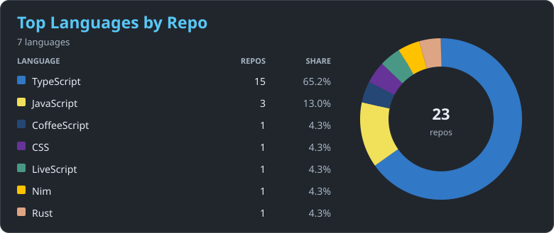
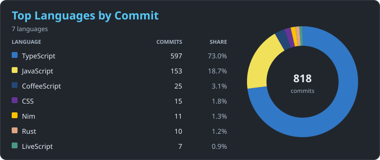
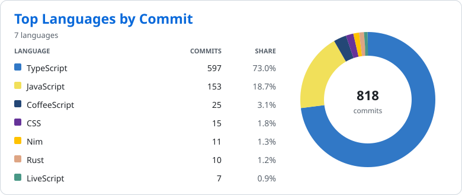

# GitHub Profile Cards

**More languages. Less noise.**

Generate customizable SVG cards for a GitHub profile, focused on the **long tail of programming languages** rather than Stars, streaks, or activity graphs. Built with TypeScript and **Node.js 26**, and distributed as a GitHub Action. No server or app deployment is required.

## Style gallery

Every theme is generated by default and saved under `profile-card-output/<theme>/`. Here are reproducible SVG examples from [naoiw](https://github.com/naoiw)'s **public** GitHub data (snapshot: 2026-11-21). Both themes are displayed here so you can compare them without changing your GitHub appearance. **Click any card to open this project repository.**

### Dark

**Top Languages by Repo** — each owned, non-fork repository contributes one count for its primary language.

[](https://github.com/naoiw/github-profile-cards)

**Top Languages by Commit** — commit contributions are attributed to the repository's primary language.

[](https://github.com/naoiw/github-profile-cards)

### Light

**Top Languages by Repo**

[](https://github.com/naoiw/github-profile-cards)

**Top Languages by Commit**

[](https://github.com/naoiw/github-profile-cards)

<sub>The committed gallery is a static example, not a live update of the author's activity. `npm run gallery` regenerates both themes from the frozen sample data. CI separately uploads cards generated from live public data.</sub>

## Quick start

1. Copy [examples/profile-workflow.yml](examples/profile-workflow.yml) into your profile repository (`YOUR_USERNAME/YOUR_USERNAME`) as `.github/workflows/profile-cards.yml`.
2. Set your username and optional preferences. **The sample uses `theme: all`**, generating both light and dark SVGs in one Action call.
3. Run **Actions → Update profile cards → Run workflow** once, then let the schedule refresh the files.
4. Add the following to your profile `README.md` to automatically show the appropriate theme. Each card links back to the generator repository so other users can find it:

```html
<a href="https://github.com/naoiw/github-profile-cards">
  <picture>
    <source media="(prefers-color-scheme: dark)" srcset="./profile-card-output/dark/languages-by-repo.svg">
    <source media="(prefers-color-scheme: light)" srcset="./profile-card-output/light/languages-by-repo.svg">
    
  </picture>
</a>

<a href="https://github.com/naoiw/github-profile-cards">
  <picture>
    <source media="(prefers-color-scheme: dark)" srcset="./profile-card-output/dark/languages-by-commit.svg">
    <source media="(prefers-color-scheme: light)" srcset="./profile-card-output/light/languages-by-commit.svg">
    
  </picture>
</a>
```

The Action generates local SVG files. The **calling workflow** commits them to your profile repository and therefore needs `permissions: contents: write`. No server or separate deployment is needed. Pin to a tested commit SHA or a versioned release in production; the example's `@main` automatically follows updates.

### Generated files

By default, one execution writes **all four SVGs** using the same data collected during that run:

```text
profile-card-output/
  dark/
    languages-by-repo.svg
    languages-by-commit.svg
  light/
    languages-by-repo.svg
    languages-by-commit.svg
```

`theme: dark` or `theme: light` limits generation to a single theme, **but the theme subdirectory remains**. `output-dir` overrides only the root directory. The `chart` setting (`donut` or `bars`) is independent of theme: it selects one chart layout per execution.

### Action configuration

| Input | Default | Description |
| --- | --- | --- |
| `username` | Current repository owner | GitHub account to analyze |
| `token` | Calling workflow's `github.token` | Read token for GraphQL |
| `top-n` | `12` | Maximum named languages (1–30) |
| `chart` | `donut` | `donut` or `bars` |
| `theme` | **`all`** | `all`, `dark`, or `light` |
| `output-dir` | **`profile-card-output`** | Output root containing per-theme directories |
| `hide-others` | `false` | Hide the long-tail Others category |
| `exclude-archived` | `false` | Exclude archived repositories |
| `exclude-repos` | Empty | Comma-separated repository names |
| `exclude-languages` | Empty | Comma-separated language names |

The caller's `github.token` is attempted for public data. If insufficient, pass an appropriately scoped read token using the optional `token` input and GitHub Actions secrets.

## What the statistics mean

- **By Repo:** Counts owned, non-fork public repositories by GitHub `primaryLanguage`.
- **By Commit:** Groups GitHub commit contributions by each repository's `primaryLanguage`, **not** by changed-file languages.
- **Percentages:** Calculated from the full included distribution. `Others` combines categories beyond Top N. Tiny nonzero shares display as `<0.1%`.
- **Languages and colors:** Names and colors are obtained dynamically from GitHub GraphQL; unknown color values fall back to neutral gray. Private repositories are excluded in this release.

## Local development

Requires **Node.js 26**. Install development dependencies for the strict type checker; no application build or runtime dependencies are needed.

```bash
npm install --no-audit --no-fund
npm run check
npm run typecheck
npm test
npm run demo -- --username demo
npm run gallery:check
```

The demo uses synthetic values, writes all four SVGs under `demo-output/` (both themes), and does not contact GitHub. It never overwrites the committed README gallery. For live data, set `GITHUB_TOKEN` and run:

```bash
npm run generate -- --username YOUR_USERNAME --top-n 12
```

To regenerate the repository's fixed samples, run `npm run gallery`. Sample generation always covers both themes and the committed files are validated in CI. For an independent public-repository language cross-check, run `npm run verify -- --username YOUR_USERNAME` with `GITHUB_TOKEN` set.

## Documentation and contributions

- [Architecture and metric definitions, accuracy limits and verification](docs/ARCHITECTURE.md)
- [Development and testing](docs/DEVELOPMENT.md)
- [Contributing guide](CONTRIBUTING.md)
- [Original GitHub Profile Summary Cards project](https://github.com/vn7n24fzkq/github-profile-summary-cards), referenced for its data-acquisition approach; code and rendering are independently implemented here.

Licensed under [MIT](LICENSE).
