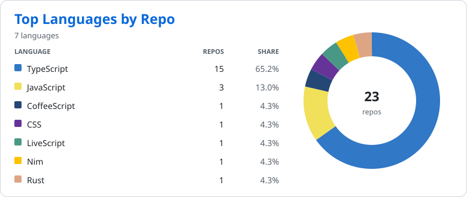
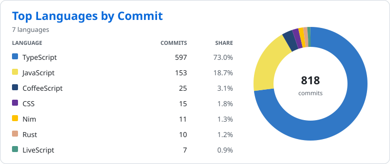

# GitHub Profile Cards

**More languages. Less noise.**

Generate customizable SVG cards for a GitHub profile, focused on the **long tail of programming languages** rather than Stars, streaks, or activity graphs. Built with TypeScript and **Node.js 26**, and distributed as a GitHub Action. No server or app deployment is required.

## Gallery

Two real examples generated from [naoiw](https://github.com/naoiw)'s **public** GitHub data. GitHub automatically shows a matching light or dark card.

### Top Languages by Repo

Each owned, non-fork repository contributes one count for its *primary language*.

<picture>
  <source media="(prefers-color-scheme: dark)" srcset="docs/previews/dark/languages-by-repo.svg">
  <source media="(prefers-color-scheme: light)" srcset="docs/previews/light/languages-by-repo.svg">
  
</picture>

### Top Languages by Commit

GitHub commit contributions are attributed to the *repository's primary language*—**not the language of each changed file**.

<picture>
  <source media="(prefers-color-scheme: dark)" srcset="docs/previews/dark/languages-by-commit.svg">
  <source media="(prefers-color-scheme: light)" srcset="docs/previews/light/languages-by-commit.svg">
  
</picture>

<sub>Static sample snapshot: 2026-11-21. These SVGs are committed to the repository; the PR CI also generates fresh previews as downloadable artifacts.</sub>

## Quick start: use in your profile

1. Copy [examples/profile-workflow.yml](examples/profile-workflow.yml) to the profile repository `YOUR_USERNAME/YOUR_USERNAME` as `.github/workflows/profile-cards.yml`.
2. Set the Action `username`, `top-n`, `chart` and `theme` inputs as desired.
3. Trigger the workflow once using **Actions → Update profile cards → Run workflow**. Scheduled runs will refresh the SVGs afterwards.
4. Add the generated images to your profile `README.md`:

```markdown


```

The sample workflow commits the generated files to **your** profile repository; this generator's Action only writes local output files and does **not** push. The caller needs `permissions: contents: write` to commit SVGs. Pin the Action to a tested full commit SHA or versioned release for long-term use; the example's `@main` follows the latest code.

### Action configuration

| Input | Default | Description |
| --- | --- | --- |
| `username` | Current repository owner | GitHub account to analyze |
| `token` | Calling workflow's `github.token` | Read token for GitHub GraphQL |
| `top-n` | `12` | Maximum named languages (1–30) |
| `chart` | `donut` | `donut` or `bars` |
| `theme` | `dark` | `dark` or `light` |
| `output-dir` | `cards` | Relative output directory |
| `hide-others` | `false` | Hide the long-tail Others category |
| `exclude-archived` | `false` | Exclude archived repositories |
| `exclude-repos` | Empty | Comma-separated repositories |
| `exclude-languages` | Empty | Comma-separated language names |

The caller's `github.token` is tried by default for public data. If it cannot access the required GraphQL contributions, pass a separately configured, appropriately scoped read token using the `token` input. Never commit tokens into the repository.

To display automatically switching light/dark cards in your own profile, generate **both** themes with separate Action calls and different `output-dir` values, then embed them with the `<picture>` approach used by this gallery. The MVP does not produce both themes in one Action invocation.

## What the statistics mean

- **By Repo:** Count of *owned non-fork public repositories* by their GitHub `primaryLanguage`. Unclassified repositories do not contribute.
- **By Commit:** Eligible GitHub commit contributions per repository, assigned to each repository's `primaryLanguage`. Contributions to other owners' repositories may count. It does **not** inspect changed file extensions or changed lines.
- **Percentages:** Always use the full included language distribution as the denominator. `Others` groups categories beyond the Top N cap. Tiny nonzero shares are shown as `<0.1%` rather than `0.0%`.
- **Languages and colors:** Language names and primary colors come from GitHub GraphQL, not from a hard-coded language whitelist. Unknown colors receive a neutral fallback. Private repositories are excluded in the current release.

The output always consists of `languages-by-repo.svg` and `languages-by-commit.svg` inside the selected output directory.

## Local development

Requires **Node.js 26** (see `.nvmrc`). The runtime uses Node's native TypeScript type stripping; there is no application build or npm dependency installation.

```bash
npm run check
npm test
npm run demo -- --username demo
npm run gallery:check
```

The demo uses **synthetic values** without hitting GitHub. For a live run, set a `GITHUB_TOKEN` environment variable and execute:

```bash
npm run generate -- --username naoiw --top-n 12 --chart donut --theme dark
```

You can refresh the committed sample gallery with `npm run gallery` (it uses the frozen public example dataset, not your personal GitHub token). Additional CLI options mirror the Action options.

## Documentation and contributing

- [Architecture and metric definitions](docs/ARCHITECTURE.md)
- [Development and testing](docs/DEVELOPMENT.md)
- [Contributing guidelines](CONTRIBUTING.md)
- [Original GitHub Profile Summary Cards project](https://github.com/vn7n24fzkq/github-profile-summary-cards), referenced for its GitHub GraphQL aggregation approach; code and SVG rendering here are independently implemented.

Licensed under [MIT](LICENSE).
